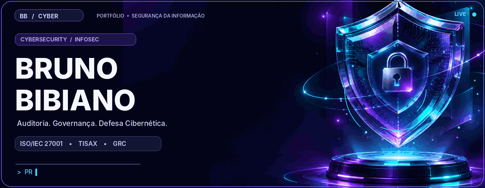
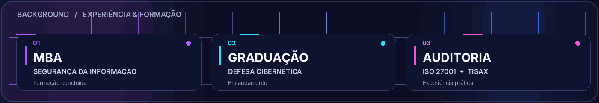
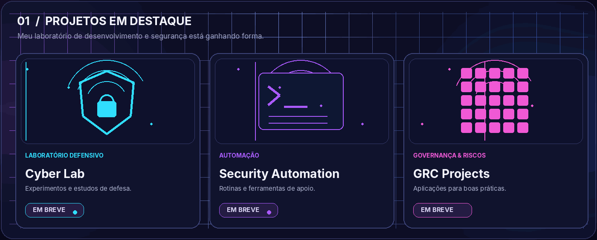
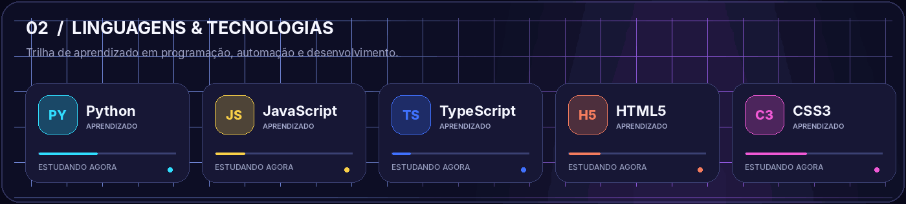
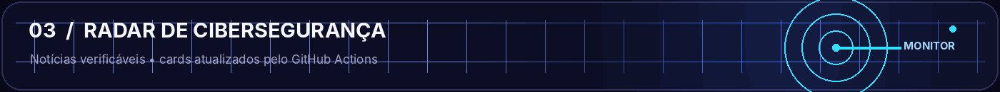
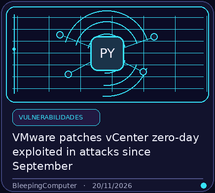
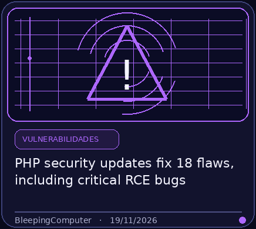
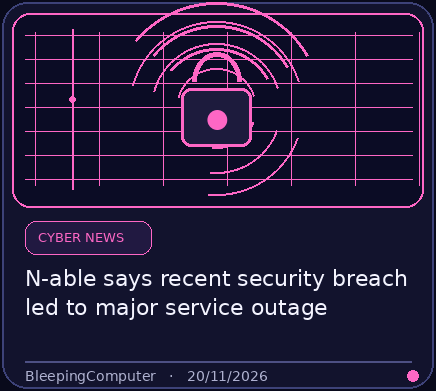

<!--
  Bruno Bibiano | Perfil GitHub / Cybersecurity Editorial
  Imagens e GIFs 100% locais no diretório assets.
  Para trocar ou atualizar notícias: scripts/update_news.py
  Visual GitHub README: GIFs e HTML permitido; sem JavaScript.
-->

  

  
  
  
  

  

  
<b>Conheça minha trajetória profissional</b>

   
  Sou profissional da área de <b>Segurança da Informação</b>, com MBA em Segurança da Informação e experiência em auditoria, gestão e melhoria de práticas relacionadas à <b>ISO/IEC 27001</b> e ao <b>TISAX</b>. Atualmente estou cursando uma graduação em <b>Defesa Cibernética</b>.
    
  Estou expandindo meus conhecimentos de programação para criar ferramentas e automações úteis à segurança e à governança. Os projetos que pretendo publicar aqui refletem esse aprendizado em construção.

## Projetos

  

Projetos previstos — ainda não publicados. Os cards são conceitos visuais, não repositórios existentes.

## Linguagens e tecnologias

  

## Radar de cibersegurança

  

<!-- NEWS:START -->
<table><tr>
<td width="33%"></td>
<td width="33%"></td>
<td width="33%"></td>
</tr></table>

Fonte: BleepingComputer · Títulos originais podem estar em inglês · Data da última seleção: 2026-11-25 · Clique nos cards para ler a matéria.

<!-- NEWS:END -->

  <a href="https://www.bleepingcomputer.com/news/security/">Mais notícias de segurança</a> •
  <a href="https://cert.br/">CERT.br</a> •
  <a href="https://www.cisa.gov/news-events/cybersecurity-advisories">CISA Advisories</a>

  

<!-- Todos os recursos dinâmicos são imagens animadas; o GitHub não permite executar JavaScript no README. -->
