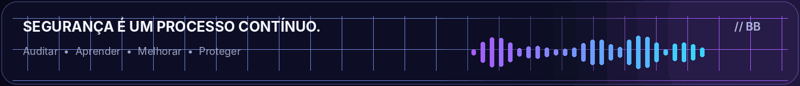

<!--
  PROFILE README — Bruno Bibiano
  Visual original: dashboard dark / neon discreto.
  Assets animados em ./assets/ (GIFs funcionam no GitHub sem JavaScript).
-->

  

  
  

  

  

  

  Os projetos são experimentos e estudos em evolução. O aprendizado é contínuo.

  
<b>Sobre mim / About me</b>

   
  Sou profissional de Segurança da Informação, com experiência em governança, ISO/IEC 27001, TISAX e melhoria contínua. Tenho interesse em usar tecnologia para resolver problemas reais, automatizar tarefas e transformar dados em informações úteis. Estou desenvolvendo minhas habilidades de programação por meio de projetos práticos, especialmente com Python e desenvolvimento web.

<!-- Gráfico dinâmico opcional. Se preferir um README 100% independente de serviços de terceiros,
     remova o trecho abaixo. O site do gráfico pode ficar indisponível temporariamente. -->

  
<b>Ver minha atividade no GitHub</b>

   
  

    
  

  

<!--
  EXTRA OPCIONAL: COBRA ANIMADA NAS CONTRIBUIÇÕES
  1. Suba .github/workflows/snake.yml ao repositório.
  2. Na aba Actions, execute o workflow 'Update contribution snake'.
  3. Depois que a branch 'output' existir, descomente o bloco abaixo:

  

    
  

-->
